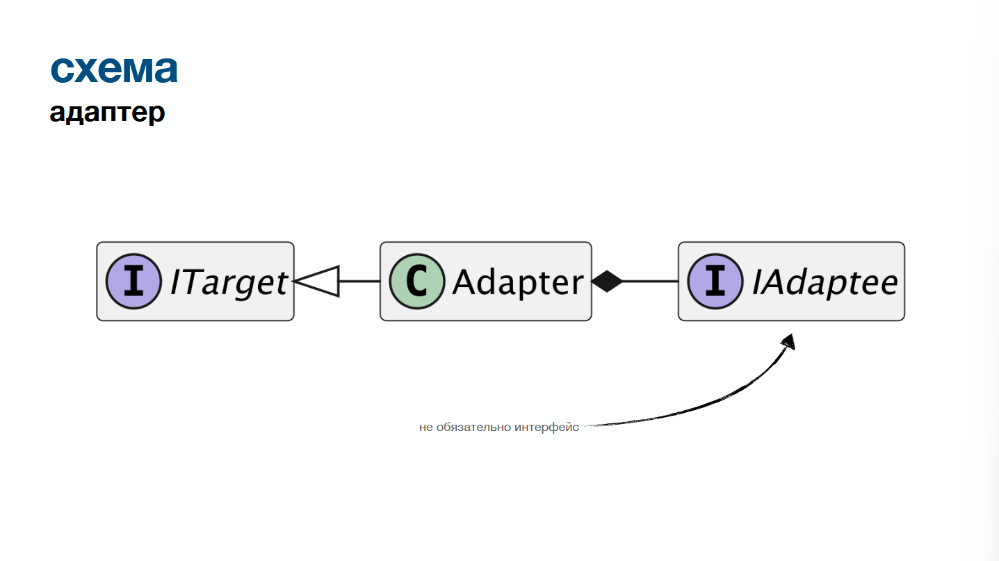
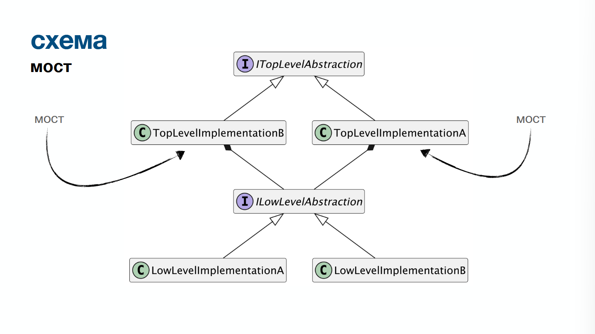
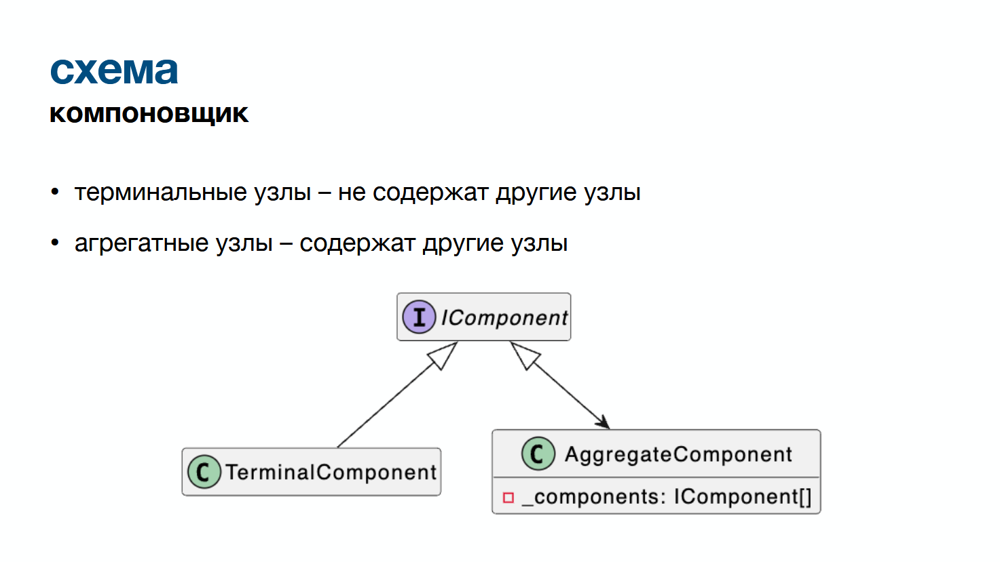
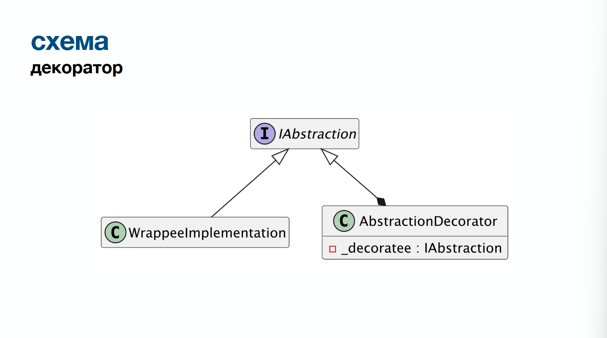
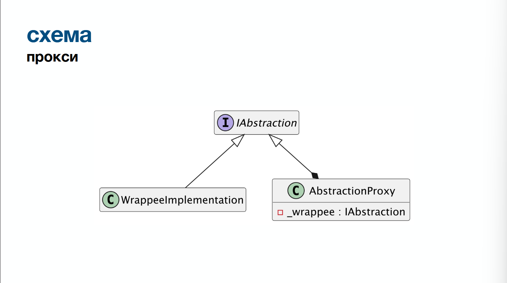

<details open>
<summary><strong>Содержание</strong></summary>

- **[Введение](#section-001)**
    - [Что такое паттерны?](#section-002)
    - [Зачем нужны паттерны?](#section-003)
    - [Паттерн != калька](#section-004)
    - [Проблема](#section-005)
    - [Структурные паттерны](#section-006)
- **[Адаптер](#section-007)**
    - [Проблематика](#section-008)
    - [Адаптер](#section-009)
    - [Структура](#section-010)
    - [Схема](#section-011)
    - [Кейс 1](#section-012)
        - [Проблемы](#section-013)
        - [Пример использования](#section-014)
        - [Результат](#section-015)
    - [Кейс 2](#section-016)
        - [Проблемы](#section-017)
        - [Пример использования](#section-018)
        - [Результат](#section-019)
- **[Мост](#section-020)**
    - [Проблема](#section-021)
        - [Мост](#section-022)
        - [Схема](#section-023)
    - [Кейс](#section-024)
        - [Проблематика](#section-025)
        - [Наивная реализация 1](#section-026)
        - [Наивная реализация 2](#section-027)
        - [Пример использования](#section-028)
            - [Замечания:](#section-029)
        - [Связь с другими принципами](#section-030)
- **[Компоновщик](#section-031)**
    - [Проблема](#section-032)
    - [Компоновщик](#section-033)
    - [Схема](#section-034)
    - [Кейс](#section-035)
        - [Проблема](#section-036)
        - [Наивная реализация](#section-037)
        - [Пример использования](#section-038)
- **[Декоратор](#section-039)**
    - [Проблема](#section-040)
    - [Декоратор](#section-041)
    - [Структура](#section-042)
    - [Схема](#section-043)
    - [Кейс](#section-044)
        - [Проблематика](#section-045)
        - [Наивная реализация](#section-046)
        - [Пример использования](#section-047)
- **[Прокси](#section-048)**
    - [Проблема](#section-049)
    - [Прокси](#section-050)
    - [Схема](#section-051)
    - [Виды прокси](#section-052)
        - [virtual / lazy](#section-053)
        - [defensive](#section-054)
        - [caching](#section-055)
    - [Кейс](#section-056)
        - [Проблематика](#section-057)
    - [Наивная реализация](#section-058)
    - [Пример использования](#section-059)
- **[Фасад](#section-060)**
    - [Проблема](#section-061)
    - [Фасад](#section-062)
    - [Кейс](#section-063)
    - [Пример использования](#section-064)
    - [На что обратить внимание:](#section-065)
- **[Легковес](#section-066)**
    - [Проблема](#section-067)
    - [Легковес](#section-068)
    - [Кейс](#section-069)
        - [Проблематика](#section-070)
        - [Наивная реализация](#section-071)
        - [Пример использования](#section-072)
- **[Фичи C# из лекции](#section-073)**
    - [MemberNotNull и NotNullWhen](#section-074)
        - [MemberNotNull(имя)](#section-075)
        - [MemberNotNullWhen(true, ...)](#section-076)
        - [NotNull](#section-077)
        - [NotNullWhen(true)](#section-078)
    - [`Lazy<T>`](#section-079)

</details>

---

<a name="section-001"></a>

# Введение

<a name="section-002"></a>

## Что такое паттерны?
Паттерны - устоявшиеся шаблоны для решения определённых проблем проектирования
В контексте ООП говорим про паттерны GoF (GoF - Gang of Four, Банда четырёх - 23 классические шаблоны проектирования ООП, их разделяют на 3 категории: порождающие, структурные, поведенческие)
Проблемы проектирования - какие-то задачи по моделированию структуры / логики

<a name="section-003"></a>

## Зачем нужны паттерны?
- Стандартные решения определённых проблем
	- "единый язык" дизайна ПО, проще понимать при командной разработке
	- по выбранному паттерну можно определить решаемую проблему
- Для чего изучать:
	- познакомиться со стандартными проблемами при проектировании объектной модели
	- познакомиться со стандартными решениями этих проблем

<a name="section-004"></a>

## Паттерн != калька
Паттерн - это отправная точка, референс. Использовать паттерн - не значит написать 1в1 как в интернете / на лекции. Конкретная бизнес-логика уникальна, поэтому реализация паттерна может отходить от "сухого стандарта", если логика того требует. 
Паттерны можно комбинировать друг с другом

<a name="section-005"></a>

## Проблема
ООП - про взаимодействие объектов:
- мы выделяем какие-то сущности в системе
- мы выделяем какую-то логику в системе
Как сделать так, чтобы эта логика превратилась в адекватную объектную модель?
- Ориентируясь на принципы SOLID понимаем, что есть проблема в реализации, используем паттерн, чтобы её решить

<a name="section-006"></a>

## Структурные паттерны
Решают проблему структурирования логики
"Как мне разделить всё это на классы, чтобы было хорошо?"

<a name="section-007"></a>

# Адаптер

<a name="section-008"></a>

## Проблематика
1. Хочу использовать объект какого-то типа в другом месте, но это кажется не правильно. 
2. Когда мы подстраиваем логику одного класса под абстракции других - каждый раз приходится переписывать логику этого класса.
3. Есть объект одного типа, который мы хотим использовать как объект другого типа, но по определённым причинам не можем

<a name="section-009"></a>

## Адаптер
Промежуточный тип, использующий объект одного типа, для реализации интерфейса другого типа

<a name="section-010"></a>

## Структура
**🔴target**
Целевой интерфейс, через который мы хотим взаимодействовать с объектом, изначально его не реализующим

**🟡adaptee**
адаптируемый тип

**🟠adapter**
тип-обёртка, реализует целевой интерфейс, содержит объект адаптируемого типа, перенаправляет в него вызовы поведений целевого интерфейса

<a name="section-011"></a>

## Схема


<a name="section-012"></a>

## Кейс 1
- существует **🟣бизнесовая** и **🟢инфраструктурная** реализации
- **🟢инфраструктурная** реализация нам не подконтрольна (идёт из библиотеки)
**🟢инфраструктурная:**
```csharp
public class SentryClient 
{
	public void SaveLog(
		string message,
		DateTimeOffset timestamp,
		int severity)
	{
		...
	}
}
```

**🟣бизнесовая:**
```csharp
public class SomeService(
	SentryClient sentryClient)
{
	public void DoOperation()
	{
		sentryClient.SaveLog(
			"Started operation",
			DateTimeOffset.UtcNow,
			severity: 1);
	}
}
```

<a name="section-013"></a>

### Проблемы
1. если сменится провайдер логов, нужно менять бизнес-логику
2. детали **🟢инфраструктурной** реализации протекают в клиент
3. Нарушение DIP
4. Но мы не можем реализовать интерфейс в GraylogClient


<a name="section-014"></a>

### Пример использования
**🔴target**
```csharp
public interface ILogger
{
	void LogInformation(string message);
}
```

**🟠adapter**
```csharp
public class SentryLogger(
	SentryClient sentryClient)
	: ILogger
{
	public void LogInformation(string message)
	{
		sentryClient.SaveLog(
			message,
			DateTimeOffset.Now,
			severity: 1);
	}
}
```

**🟡adaptee**
```csharp
...
	SentryClient sentryClient)
...
```

Использование:
```csharp
public class SomeService(
	ILogger logger)
{
	public void DoOperation()
	{
		logger.LogInformation("Started operation");
	}
}
```

<a name="section-015"></a>

### Результат
- бизнесовая реализация зависит от абстракции - соблюдаем DIP
- можем безболезненно заменить реализацию - OCP/protected variations

<a name="section-016"></a>

## Кейс 2
- существует **🟢бизнесовая 1** и **🔵бизнесовая 2** реализации
- реализации **🟢бизнесовая 1** нужно использовать реализацию **🔵бизнесовая 2**
- реализации **🟢бизнесовая 1** может быть нужно использовать другие реализации
- реализация **🔵бизнесовая 2** не должна знать о реализации  **🟢бизнесовая 1**

**🟢бизнесовая 1**
```csharp
public interface IAdressee
{
	void ReceiveMessage(string message);
}
```

```csharp
public class Messenger(
	IReadOnlyCollection<IAdressee> adressees)
{
	public void SendMessage(string message)
	{
		foreach (IAdressee adressee in adressees)
		{
			adressee.ReceiveMessage(message);
		}
	}
}
```

**🔵бизнесовая 2**
```csharp
public class User
{
	private readonly List<string> _receivedMessages = [];
	
	public void StoreMessage(string message) 
	{
		_receivedMessages.Add(message);
	}
}
```

<a name="section-017"></a>

### Проблемы
1. Мы хотим использовать User в качестве IAdressee
2. Метод User.StoreMessage может вызываться в других местах
3. User не должен знать про Messanger и его абстракции
4. Поэтому мы не можем просто реализовать IAdressee в User - нарушение SRP

<a name="section-018"></a>

### Пример использования
**🔴target**
```csharp
public interface IAdressee
{
	void ReceiveMessage(string message);
}
```

**🟠adapter**
```csharp
public class UserAdressee(
	User user)
	: IAdressee
{
	void ReceiveMessage(string message)
	{
		user.StoreMessage(message);
	}
}
```

**🟡adaptee**
```csharp
...
	User user)
...
```


<a name="section-019"></a>

### Результат
- User не связан с абстракциями Messenger - соблюдаем SRP
- при добавлении новых интеграций User с другими частями объектной модели, делаем новые адаптеры
	- тип User не засоряется связями с другими абстракциями
	- тип User необходимо тестировать только в контексте его функционала

<a name="section-020"></a>

# Мост

<a name="section-021"></a>

## Проблема
Проблема: есть составная логика и:
* можно выделить несколько уровней реализации этой логики
* каждый уровень может варьироваться
* вариации на разных уровнях могут комбинироваться между собой
*Как понять, что переиспользовать, а что дублировать?*

<a name="section-022"></a>

### Мост
разделение объектной модели на абстракции разных уровней реализации 
Абстракции более высокого уровня, использующие абстракции более низкого уровня, и являются "мостом".
Мост - идея декомпозиции логики на абстракции разного уровня, остальное - детали реализации
Чем больше логика - бизнес-логика, тем выше уровень её абстракции. Низкоуровневая логика имеет больший потенциал к переиспользованию (бизнес-бизнес). Инфраструктурная логика всегда внизу (бизнес - инфраструктурная).

<a name="section-023"></a>

### Схема


<a name="section-024"></a>

## Кейс

<a name="section-025"></a>

### Проблематика
1. Существует программа, которая на определённом пиксельном холсте рисует фигуры.
2. Фигуры могут быть разными (круг, квадрат, ...)
3. Холсты могут быть разными (консоль, PNG, JPEG, ...)

<a name="section-026"></a>

### Наивная реализация 1
```csharp
public interface IShape
{
	void Render();
}
```

```csharp
public class ConsoleCircle : IShape { ... }

public class PngCircle : IShape { ... }

public class JpegCircle : IShape { ... }
```
- комбинаторный взрыв - каждая комбинация = отдельный класс
- дубликация всей логики:
	- отрисовки фигуры
	- вывода на "холст"
- нет переиспользования
	- проще допустить ошибку
	- обновление логики - внесение одинаковых изменений в разные классы
- нарушаем OCP

<a name="section-027"></a>

### Наивная реализация 2

**Наивная через enum-type фигуры**

```csharp
public enum ShapeType
{
	Circle,
	Square,
}

public class ConsoleShape(
	ShapeType type)
	: IShape
{
	public void Render()
	{
		switch (type)
		{
			...
		}
	}
}
```
или

**Наивная через enum-type холста**

```csharp
public enum OutputType
{
	Console,
	Png,
	Jpeg,
}

public class Circle(
	OutputType type)
	: IShape
{
	public void Render()
	{
		switch (type)
		{
			...
		}
	}
}
```
или

**Наивная через наследование абстрактного класса (по сути тот же enum)**

```csharp
public abstract class Circle : IShape
{
	public abstract void Render();
	
	protected int[,] CalculatePixels() { ... }
}

public class ConsoleCircle : Circle
{
	public override void Render()
	{
		int[,] pixels = CalculatePixels();
		...
	}
}

public class PngCircle : Circle
{
	public override void Render()
	{
		int[,] pixels = CalculatePixels();
		...
	}
}

public class JpegCircle : Circle
{
	public override void Render()
	{
		int[,] pixels = CalculatePixels();
		...
	}
}
```

<a name="section-028"></a>

### Пример использования

**top-level abstraction**

```csharp
public interface IShape
{
	void Render(IRenderingEngine engine);
}
```


**top-level abstraction**

```csharp
public interface IRenderingEngine
{
	void RenderPixels(int[,] pixels);
}
```


**top-level implementations**

```csharp
public class Circle : IShape
{
	public void Render(
		IRenderingEngine engine)
	{
		...
	}
}

public class Square : IShape
{
	public void Render(
		IRenderingEngine engine)
	{
		...
	}
}
```


**low-level implementations**

```csharp
public class ConsoleRenderingEngine
	: IRenderingEngine
{
	public void RenderPixels(
		int[,] pixels)
	{
		...
	}
}

public class PngRenderingEngine(
	string fileName)
	: IRenderingEngine
{
	public void RednerPixels(
		int[,] pixels)
	{
		...
	}
}
```


**Use example**

```csharp
var circle = new Circle();
var square = new Square();

var consoleEngine = new ConsoleRenderingEngine();
var pngEngine = new PngRenderingEngine("shape.png")
var jpegEngine = new JpegRenderingEngine("shape.jpeg")

circle.Render(consoleEngine)
circle.Render(pngEngine)
circle.Render(jpegEngine)

square.Render(consoleEngine)
square.Render(pngEngine)
square.Render(jpegEngine)
```

<a name="section-029"></a>

#### Замечания:
- не использована композиция
	- не значит, что она не может быть использована
	- не значит, что использование композиции = не мост
- мост - сама идея декомпозиции логики на абстракции разного уровня; остальное - детали реализации

<a name="section-030"></a>

### Связь с другими принципами
- способ реализации OCP
- способ реализации protected variations
- "подвид" адаптера:
	- мост больше уходит в полиморфизм для реализации и OCP
	- адаптер больше уходит в изоляцию логики и SRP

<a name="section-031"></a>

# Компоновщик

<a name="section-032"></a>

## Проблема
Есть составная/иерархичная структура данных:
- есть логика, выполняемая над каждым элементом
- для разных элементов логика может отличаться

<a name="section-033"></a>

## Компоновщик
представление древовидной структуры объектов  в виде одного композитного объекта.

<a name="section-034"></a>

## Схема

Очень конкретный юзкейс полиморфизма, но достаточно встречаемый, так что вынесен в отдельный паттерн
Можно выделить:
- обязательное отношение часть/целое
- возможность работы с составными объектами как с единым целым

<a name="section-035"></a>

## Кейс

<a name="section-036"></a>

### Проблема
Разработка photoshop-подобного графического редактора
- есть разные элементы (круг, квадрат, ...)
- есть группы элементов
- все элементы можно передвигать
	- при передвижении группы-элементов, передвижение должно транслироваться всем элементам группы

<a name="section-037"></a>

### Наивная реализация

**Реализация типов**

```csharp
public interface IGraphicComponent
{
	Position Position { get; set; }
}

public class Circle : IGraphicComponent
{
	public Position Position { get; set; }
}

public class Square : IGraphicComponent
{
	public Position Position { get; set; }
}

public class ComponentGroup : IGraphicComponent
{
	public Position Position { get; set; }
	public List<IGraphicComponent> Components { get; } = [];
}
```


**Метод меремещения**

```csharp
void MoveBy(IGraphicComponent component, int x, int y)
{
	if (component is Circle circle)
	{
		circle.Position = new Position(
			circle.Position.X + x.
			circle.Position.Y + y);
	}
	
	if (component is Square square)
	{
		square.Position = new Position(
			square.Position.X + x.
			square.Position.Y + y);
	}
	
	if (component is ComponentGroup group)
	{
		foreach (IGraphicComponent child in group.Components)
		{
			MoveBy(child, x, y);
		}
	}
}
```
- нарушение OCP: костыли над полиморфизмом
- нарушение LSP: свойство Position у ComponentGroup - фиктивное
- нарушение DIP: используем знания о реализации низкоуровневой логики

<a name="section-038"></a>

### Пример использования

**Компоновщик**

```csharp
public interface IGraphicComponent
{
	void MoveBy(int x, int y);
}
```


**Терминальные узлы**

```csharp
public class Circle(
	Position position) 
	: IGraphicComponent
{
	public Position Position { get; private set; } = position;
	
	public MoveBy(int x, int y)
	{
		Position = Position.MoveBy(x, y);
	}
}

public class Square(
	Position position) 
	: IGraphicComponent
{
	public Position Position { get; private set; } = position;
	
	public MoveBy(int x, int y)
	{
		Position = Position.MoveBy(x, y);
	}
}
```


**Аггрегирующий компонент**

```csharp
public class ComponentGroup(
	IEnumerable<IGraphicComponent> components)
	: IGraphicComponent
{
	private readonly List<IGraphicComponent> _components = [... components];
	
	public void MoveBy(int x, int y)
	{
		foreach (IGraphicComponent component in _components)
		{
			component.MoveBy(x, y);
		}
	}
}
```

<a name="section-039"></a>

# Декоратор

<a name="section-040"></a>

## Проблема
Существует тип/набор типов, необходимо добавить к их объектам какое-то поведение.

<a name="section-041"></a>

## Декоратор
тип-обёртка, дополняющий логику объекта, который реализует ту же абстракцию

<a name="section-042"></a>

## Структура
 **🟢абстракция**
 какой-либо интерфейс, определяющий поведения
**🔴декоратор**
тип, реализующий абстракцию, содержащий объект данной абстракции
**🔵decoratee**
объект типа, реализующего абстракцию, оборачиваемый в декоратор

<a name="section-043"></a>

## Схема


<a name="section-044"></a>

## Кейс

<a name="section-045"></a>

### Проблематика
Разработка кассовой системы:
- существуют штучные товары
- существуют групповые упаковки товаров
- необходимо иметь возможность получить стоимость товара
- необходимо иметь возможность применять скидки к товарам
```csharp
public interface IProduct
{
	decimal CalculateCost();
}

public class SingularItem(
	decimal price)
	: IProduct
{
	public decimal CalculateCost()
	{
		return price;
	}
}

public class GroupPackageItems(
	IReadOnlyCollection<IProduct> products)
	: IProduct
{
	public decimal CalculateCost()
	{
		return products
			.Sum(product => product.CalculateCost());
	}
}
```

<a name="section-046"></a>

### Наивная реализация

**Вариант 1**

```csharp
public class SingularItem(
	decimal price,
	decimal discount)
	: IProduct
{
	public decimal CalculateCost()
	{
		return price * (1 - discount);
	}
}

public class GroupPackageItems(
	IReadOnlyCollection<IProduct> products.
	decimal discount)
	: IProduct
{
	public decimal CalculateCost()
	{
		decimal cost = products
			.Sum(product => product.CalculateCost());
			
		return cost * (1 - discount);
	}
}
```
- нарушение SRP: классы ответственны и за свою логику, и за логику расчёта скидки
- нарушение OCP: если логика расчёта скидки изменится, нужно изменить все реализации
- дубликация логики


**Вариант 2**

```csharp
public class DiscountedSingularItem(
	decimal price,
	decimal discount)
	: SingularItem(price)
{
	public override decimal CalculateCost()
	{
		return base.CalculateCost() * (1 - discount);
	}
}

public class DiscountedGroupPackageItems(
	IReadOnlyCollection<IProduct> products,
	decimal discount)
	: IProduct
{
	public override decimal CalculateCost()
	{
		return base.CalculateCost() * (1 - discount);
	}
}
```
- нарушение SRP
	- логика в двух классах, но наследник всё ещё ответственен и за свой функционал, и за расчёт скидки
- комбинаторный взрыв наследников: каждый модификатор = декартово произведение
- сильная связанность наследников
	- изменится конструктор базового класса - нужно менять дочерний
- дубликация логики

<a name="section-047"></a>

### Пример использования
```csharp
public class DiscountedProduct(
	IProduct product,
	decimal discount)
	: IProduct
{
	public decimal CalculateCost()
	{
		return product.CalculateCost() * (1 - discount);
	}
}
```

<a name="section-048"></a>

# Прокси

<a name="section-049"></a>

## Проблема
Существует тип/набор типов, необходимо добавить пред-условия выполнения их операций
Похож на декоратор, но не декоратор

<a name="section-050"></a>

## Прокси
тип-обёртка, реализующий логику контроля доступа к объекту, который реализует ту же абстракцию.

<a name="section-051"></a>

## Схема


<a name="section-052"></a>

## Виды прокси

**База**

```csharp
public interface IDataStore
{
	bool TryGetValue<T>(
		string key,
		[NotNullWhen(true)] out T? value);
}

public class JsonDataStore(
	string filePath)
	: IDataStore
{
	public bool TryGetValue<T>(
		string key,
		[NotNullWhen(true)] out T? value)
		{
			...
		}
}
```

<a name="section-053"></a>

### virtual / lazy

**Конкретный тип**

```csharp
public class LazyJsonDataStore(
	string filePath)
	: IDataStore
{
	private readonly Lazy<JsonDataStore> _dataStore =
		new (() => new JsonDataStore(filePath));
		
	public bool TryGetValue<T>(
		string key,
		[NotNullWhen(true)] out T? value)
		{
			return _dataStore.Value.TryGetValue(
				key,
				out value);
		}
}
```


**Передаём функцию создания хранилища**

```csharp
public class LazyDataStore(
	Func<IDataStore> createDataStore)
	: IDataStore
{
	private readonly Lazy<JsonDataStore> _dataStore =
		new (createDataStore);
		
	public bool TryGetValue<T>(
		string key,
		[NotNullWhen(true)] out T? value)
		{
			return _dataStore.Value.TryGetValue(
				key,
				out value);
		}
}
```

<a name="section-054"></a>

### defensive
```csharp
public class AuthorizedDataStore(
	IDataStore dataStore,
	ICurrentUser currentUser)
	: IDataStore
{
	public bool TryGetValue<T>(
		string key,
		[NotNullWhen(true)] out T? value)
	{
		if (key.Contains("secure", StringComparison.OrdinalIgnoreCase)
			&& currentUser.IsAdmin is false)
		{
			value = default;
			return false;
		}
		
		return dataStore.TryGetValue(key, out value);
	}
}
```

<a name="section-055"></a>

### caching
```csharp
public class CachingDataStore(
	IDataStore dataStore)
	: IDataStore
{
	private readonly Dictionary<string, object?> _cache = [];
	
	public bool TryGetValue<T>(string key, [NotNullWhen(true)] out T? value)
	{
		if (_cache.TryGetValue(key, out object? untypedValue))
		{
			value = untypedValue is T typed ? typed : default;
			return value is not null;
		}
		
		if (dataStore.TryGetValue(key, out value))
		{
			_cache[key] = value;
			return true;
		}
		
		return false;
	}
}
```

<a name="section-056"></a>

## Кейс

<a name="section-057"></a>

### Проблематика
Необходимо реализовать класс для получения конфигураций
- загрузка конфигураций должна быть ленивой
- необходимо ограничивать доступ к объектам конфигураций
- необходимо кешировать объекты конфигураций

<a name="section-058"></a>

## Наивная реализация
```csharp
public class JsonDataStore
{
	private readonly IReadOnlyDictionary<string, JsonDocument> _values;
	
	public JsonDataStore(string filePath)
	{
		string content = File.ReadAllText(filePath);
		_values = JsonSerializer.Deserialize<Dictionary<string, JsonDocument>>(content) ?? [];
	}
	
	// Получаем конфигурации
	public bool TryGetValue<T>(
		string key,
		[NotNullWhen(true)] out T? value)
	{
		if (_values.TryGetValue(key, out JsonDocument? serialized) is false)
		{
			value = default;
			return false;
		}
		
		value = JsonSerializer.Deserialize<T>(serialized);
		return value is not null;
	}
}
```


**Добавляем ленивость**

```csharp
public class JsonDataStore(string filePath))
{
	// убрали проверку из конструктора, словарь может быть null
	private readonly IReadOnlyDictionary<string, JsonDocument>? _values;
	
	public bool TryGetValue<T>(
		string key,
		[NotNullWhen(true)] out T? value)
	{
		//Впервые загружаем файл только когда вызвали TryGetValue
		EnsureValuesLoaded();
		
		if (_values.TryGetValue(key, out JsonDocument? serialized) is false)
		{
			value = default;
			return false;
		}
		
		value = JsonSerializer.Deserialize<T>(serialized);
		return value is not null;
	}
	
	[MemberNotNull(nameof(_values))]
	private void EnsureValuesLoaded()
	{
		string content = File.ReadAllText(filePath);
		_values = JsonSerializer.Deserialize<Dictionary<string, JsonDocument>>(content) ?? [];
	}
}
```


**Добавляем ограничение доступа**

```csharp
public class JsonDataStore(
	string filePath,
	ICurrentUser currentUser)) //теперь ещё и храним пользователя
{
	private readonly IReadOnlyDictionary<string, JsonDocument>? _values;
	
	public bool TryGetValue<T>(
		string key,
		[NotNullWhen(true)] out T? value)
	{
		//добавили проверку
		if (key.Contains("secure", StringComparison.OrdinalIgnoreCase)
			&& currentUser.IsAdmin is true)
		{
			value = default;
			return false;
		}
		
		EnsureValuesLoaded();
		
		if (_values.TryGetValue(key, out JsonDocument? serialized) is false)
		{
			value = default;
			return false;
		}
		
		value = JsonSerializer.Deserialize<T>(serialized);
		return value is not null;
	}
	
	[MemberNotNull(nameof(_values))]
	private void EnsureValuesLoaded()
	{
		string content = File.ReadAllText(filePath);
		_values = JsonSerializer.Deserialize<Dictionary<string, JsonDocument>>(content) ?? [];
	}
}
```


**Добавляем кэширование**

```csharp
public class JsonDataStore(
	string filePath,
	ICurrentUser currentUser)) 
{
	private readonly Dictionary<string, object?> _valuesCache = []; //кэш
	private readonly IReadOnlyDictionary<string, JsonDocument>? _values;
	
	public bool TryGetValue<T>(
		string key,
		[NotNullWhen(true)] out T? value)
	{
		if (key.Contains("secure", StringComparison.OrdinalIgnoreCase)
			&& currentUser.IsAdmin is true)
		{
			value = default;
			return false;
		}
		
		EnsureValuesLoaded();
		
		if (_values.TryGetValue(key, out JsonDocument? serialized) is false)
		{
			value = default;
			return false;
		}
		
		//проверили в кэше
		if (_cache.TryGetValue(key, out object? untypedValue))
		{
			value = untypedValue is T typed ? typed : default;
			return value is not null;
		}
		
		value = JsonSerializer.Deserialize<T>(serialized);
		_valuesCache[key] = value; //закэшировали
		return value is not null;
	}
	
	[MemberNotNull(nameof(_values))]
	private void EnsureValuesLoaded()
	{
		string content = File.ReadAllText(filePath);
		_values = JsonSerializer.Deserialize<Dictionary<string, JsonDocument>>(content) ?? [];
	}
}
```
- god-класс
- нарушение SRP
- нарушение OCP
- плохо

<a name="section-059"></a>

## Пример использования
в [Виды прокси](#section-052)

<a name="section-060"></a>

# Фасад

<a name="section-061"></a>

## Проблема
Существует операция из нескольких действий:
- отдельные части этих действий не должны знать друг о друг
- должна быть логика вызова этих действий
- логика вызывается из нескольких мест

<a name="section-062"></a>

## Фасад
оркестрация одной или набора сложных операций в каком-либо типе.

<a name="section-063"></a>

## Кейс
Разработка системы лояльности
- при совершении покупки нужно обновить информацию
- нужно рассчитать бонусы
- нужно перевести на следующий уровень при необходимости => достать данные из хранилища
```csharp
public class User
{
	public required long Id { get; init; }
	
	public decimal BonusPoints { get; private set; }
	
	public decimal TotalPurchasedAmount { get; private set; }
	
	public void AddBonusPoints(decimal bonusPoints)
	{
		...
	}
	
	public void AddPurchasedAmount(decimal amount)
	{
		...
	}
}
```

```csharp
public class LoyaltyProgram(
	decimal bonusPayoutFraction,
	decimal maxBonusPayout)
{
	public LoyaltyProgram ProcessUserPurchase(
		User user,
		decimal purchaseAmount)
	{
		decimal bonusPayout = Math.Min(
			maxBonusPayout,
			purchaseAmount * bonusPayoutFraction);
		
		user.AddBonusPoints(bonusPayout);
		user.AddPurchasedAmount(purchaseAmount);
		
		decimal loyaltyGrade = Math.Round(user.TotalPurchsedAmount / 10_000);
		
		decimal newBonusPayoutFraction = Math.Min(1m, loyaltyGrade / 100);
		decimal newMaxBonusPayout = loyaltyGrade * 1000;
		
		return new LoyaltyProgram(newBonusPayoutFraction, newMaxBonusPayout);
	}
}
```

```csharp
public interface IUserRepository
{
	User? FindById(long userId);
	
	void Update(User user);
}

public interface ILoyaltyProgramRepository
{
	LoyaltyProgram? FindByUserId(long userId);
	
	void UpdateForUser(
		long userId,
		LoyaltyProgram loyaltyProgram)
}
```

<a name="section-064"></a>

## Пример использования
```csharp
public class UserLoyaltyService(
	IUserRepository userRepository,
	ILoyaltyProgramRepository loyaltyProgramRepository)
{
	public UserPurchaseLoyaltyResult ApplyUserPurchase(long userId, decimal purchaseAmount)
	{
		User? user = userRepository.FindById(userId);
		
		if (user is null)
			return new UserPurchaseLoyaltyResult.UserNotFound();
		
		LoyaltyProgram? loyaltyProgram = loyaltyProgramRepository.FindByUserId(userId);
		
		if (loyaltyProgram is null)
			return new UserPurchaseLoyaltyResult.UserNotEnrolled();
		
		loyaltyProgram = loyaltyProgram.ProcessUserPurchase(user, purchaseAmount);
		
		userRepository.Update(user);
		loyaltyProgramRepository.UpdateForUser(usedId, loyaltyProgram);
		
		return new UserPurchaseLoyaltyResult.Success();
	}
}
```

<a name="section-065"></a>

## На что обратить внимание:
1. Есть риск сделать god-class => стоит выделять "локальные" фасады
2. Потеря абстракций засчёт переиспользования логики внутри фасада => тяжесть рефакторинга и декомпозиции

<a name="section-066"></a>

# Легковес

<a name="section-067"></a>

## Проблема
Система работает с большим числом объектов
- объекты хранят объёмные данные
- эти объёмные данные часто повторяются между объектами

<a name="section-068"></a>

## Легковес
декомпозиция объектов, выделение тяжёлых и повторяющихся данных в отдельные модели для дальнейшего переиспользования.

<a name="section-069"></a>

## Кейс

<a name="section-070"></a>

### Проблематика
Разработка движка для компьютерной графики:
- существуют какие-то частицы
- частица имеет координаты и модель
- координаты уникальны для каждой частицы
- модель для частиц общая

<a name="section-071"></a>

### Наивная реализация
```csharp
public record Particle(int X, int Y, byte[] Model);

public class ParticleFactory
{
	private readonly IAssetLoader _assetLoader;
	
	public Particle Create(string modelName)
	{
		var model = _assetLoader.Load(modelName);
		return new Particle(0, 0, model);
	}
}
```
Плохая производительность:
- при создании каждой частицы грузим текстуры заново
- каждая частица хранит дубликат данных
- создаём много частиц - долгое создание, используем много ОЗУ

<a name="section-072"></a>

### Пример использования
```csharp
public record ModelData(byte[] Value);

public record Particle(int X, int Y, ModelData Model);

public class ParticleFactory
{
	private readonly IAssetLoader _assetLoader;
	private readonly Dictionary<string, ModelData> _cache;
	
	public Particle Create(string modelName)
	{
		var model = _cache.TryGetValue(modelName, out var data)
			? data
			: _cache[modelName] = new ModelData(_assertLoader.Load(modelName));
		
		return new Particle(0, 0, model);
	}
}
```


<a name="section-073"></a>

# Фичи C# из лекции

<a name="section-074"></a>

## MemberNotNull и NotNullWhen

<a name="section-075"></a>

### MemberNotNull(имя)
Атрибут метода
После успешного завершения метода указанный член не `null`
Предпочтительнее писать `[MemberNotNull(nameof(_values))`, хотя можно и просто `[MemberNotNull("_values")`. Преимущество - при изменении имени члена в первом случае оно так же изменится, а во втором - придётся менять руками

<a name="section-076"></a>

### MemberNotNullWhen(true, ...)
Также атрибут метода
Указанный член не null, если метод вернул `true`

<a name="section-077"></a>

### NotNull
Параметр или возвращаемое значение не `null` после успешного завершения

<a name="section-078"></a>

### NotNullWhen(true)
Параметр не `null`, если метод вернул `true`


<a name="section-079"></a>

## `Lazy<T>`
Предоставляет поддержку ленивой инициализации типа T