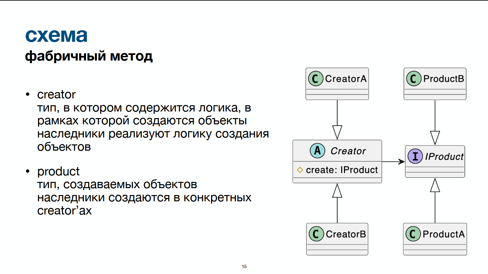
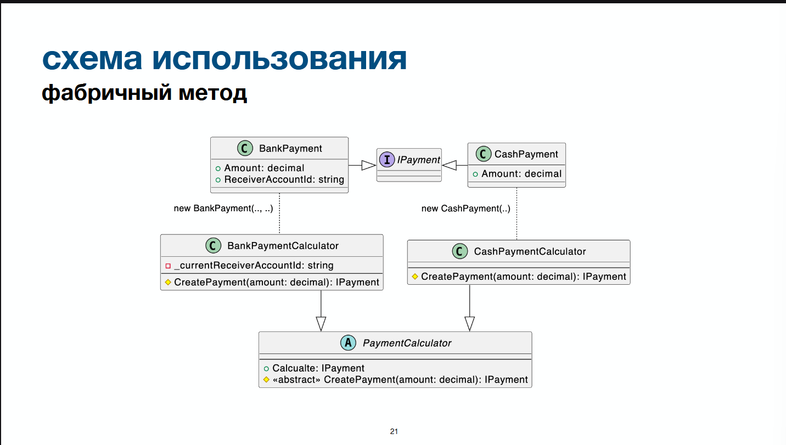
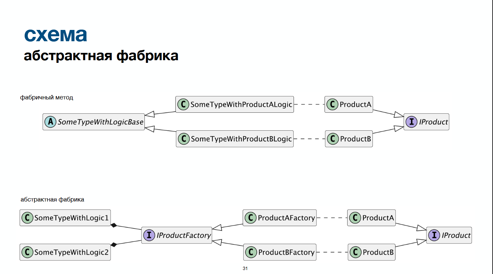
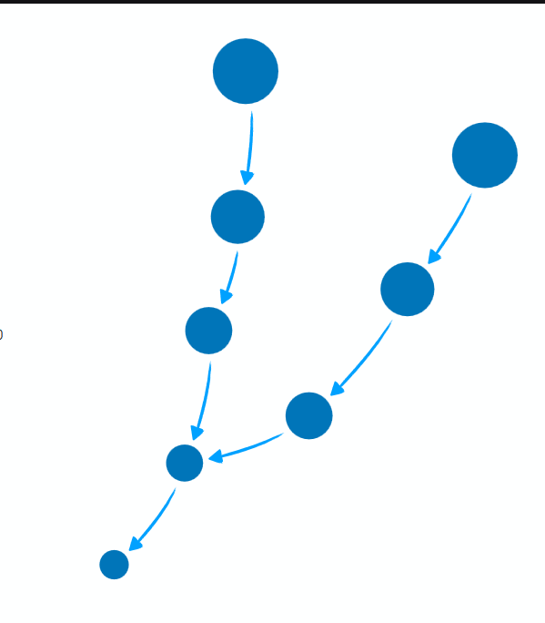
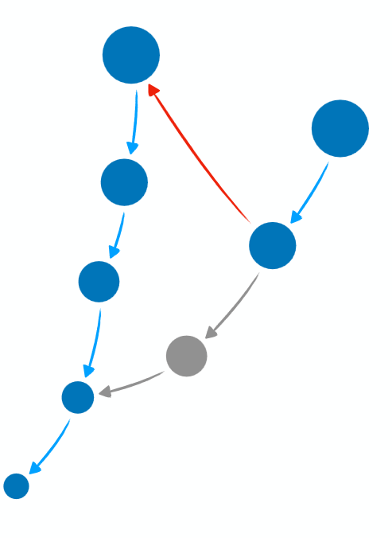
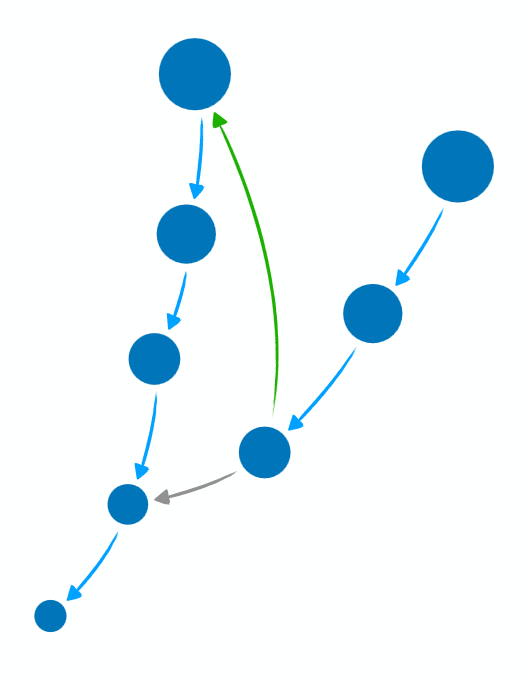

<details open>
<summary><strong>Содержание</strong></summary>

- **[Зачем?](#section-001)**
- **[Фабричный метод](#section-002)**
    - [Проблема](#section-003)
    - [Фабричный метод](#section-004)
    - [Схема](#section-005)
    - [Кейс](#section-006)
        - [Проблематика](#section-007)
        - [Наивная реализация](#section-008)
        - [Пример использования](#section-009)
            - [Преимущества](#section-010)
            - [Недостатки](#section-011)
- **[Абстрактная фабрика](#section-012)**
    - [Проблема](#section-013)
    - [(Абстрактная) фабрика](#section-014)
    - [Схема](#section-015)
    - [Кейс](#section-016)
        - [Проблематика](#section-017)
        - [Пример использования](#section-018)
            - [Преимущества](#section-019)
    - [Сравнение с фабричным методом](#section-020)
- **[Билдер](#section-021)**
    - [Проблема](#section-022)
    - [Кейс](#section-023)
        - [Проблематика](#section-024)
    - [Билдер](#section-025)
    - [Параметры и аргументы](#section-026)
        - [Параметр](#section-027)
        - [Аргумент](#section-028)
    - [Convenience builder](#section-029)
        - [Из чего состоит](#section-030)
        - [Пример в коде](#section-031)
        - [Что сделали](#section-032)
        - [Пример интеграции](#section-033)
            - [Плюсы v1](#section-034)
            - [Минусы v1](#section-035)
    - [Stateful constructor builder](#section-036)
        - [Преимущества](#section-037)
    - [Директор](#section-038)
    - [interface driven](#section-039)
- **[Прототип](#section-040)**
    - [Проблема](#section-041)
    - [Кейс](#section-042)
        - [Проблема](#section-043)
        - [Наивная реализация](#section-044)
    - [Прототип](#section-045)
    - [Виды копирования](#section-046)
        - [Shallow copy](#section-047)
        - [Deep copy](#section-048)
        - [Комбинированный](#section-049)
        - [Почему не просто конструктор?](#section-050)
    - [Полиморфизм](#section-051)
        - [Наивная реализация](#section-052)
        - [Решение](#section-053)
        - [Проблематика](#section-054)
        - [Типизация](#section-055)
            - [Типизация через наследование](#section-056)
            - [Типизация через реализацию](#section-057)
        - [Кейс](#section-058)
        - [Рекурсивный параметр-тип / Рекурсивный дженерик](#section-059)
            - [Рекурсивный параметр-тип (CRTP):](#section-060)
- **[Синглтон](#section-061)**
    - [Проблема](#section-062)
    - [Реализация](#section-063)
    - [Lazy](#section-064)
        - [LazyThreadSafetyMode](#section-065)

</details>

---

<a name="section-001"></a>

# Зачем?
В общем случае - хотим абстрагировать код, требующий создание объектов, от каких-либо деталей этого создания
- конкретные типы объектов
- какие-то дополнительные данные
- источники / способы получения данных
- внутренняя структура объектов

<a name="section-002"></a>

# Фабричный метод

<a name="section-003"></a>

## Проблема
- у меня есть логика, в рамках которой создаётся объект
- этот объект может быть разного типа

<a name="section-004"></a>

## Фабричный метод
вариативность создания объектов при помощи наследования и полиморфизма

<a name="section-005"></a>

## Схема



<a name="section-006"></a>

## Кейс

<a name="section-007"></a>

### Проблематика
Разрабатываем кассовую систему, необходимо сформировать объект платежа:
- платёж может быть нескольких типов
	- разные типы могут иметь разные данные
- для каждого типа есть общая логика
```csharp
public record OrderItem(
	decimal Price,
	int Amount)
{
	public decimal Cost => Price * Amoount;
}

public record Order(
	IEnumerable<OrderItem> Items)
{
	public decimal TotalCost
		=> Items.Sum(x => x.Cost);
}
```

```csharp
public interface IPayment
{
	decimal Amount { get; }
}

public record CashPayment(
	decimal Amount)
	: IPayment;
	
public record BankPayment(
	decimal Amount,
	string ReceiverAccountId)
	: IPayment;
```

<a name="section-008"></a>

### Наивная реализация

**Вариант 1.1. Разные методы для создания разных объектов**

```csharp
public class PaymentCalculator(
	string receiverAccountId)
{
	public CashPayment CalculateCashPayment(Order order)
	{
		decimal totalCost = order.TotalCost;
		totalCost = ApplyDiscountsAndCoupons(totalCost);
		
		return new CashPayment(totalCost);
	}
	
	public BankPayment CalculateCashPayment(Order order)
	{
		decimal totalCost = order.TotalCost;
		totalCost = ApplyDiscountsAndCoupons(totalCost);
		
		return new BankPayment(totalCost, receiverAccountId);
	}
	
	private decimal ApplyDiscountsAndCoupons(decimal totalCost)
	{
		...
	}
}
```


**Вариант 1.2. switch по типам создаваемого объекта**

```csharp
public class PaymentCalculator(
	string receiverAccountId)
{
	public IPayment Calculate(Order order, PaymentType type)
	{
		decimal totalCost = order.TotalCost;
		totalCost = ApplyDiscountsAndCoupons(totalCost);
		
		return type switch
		{
			PaymentType.Cash => new CashPayment(totalCost),
			PaymentType.Bank => new BankPayment(totalCost, receiverAccountId),
			_ => throw new UnreachableException();
		}
	}
	
	private decimal ApplyDiscountsAndCoupons(decimal totalCost)
	{
		...
	}
}
```
- Нарушаем SRP и OCP
- Один класс будет меняться для обоих типов оплаты
- Один класс должен обладать суммарными данными для всех типов оплаты (receiverAccountId не нужен в платеже типа Cash)
- Вызывающий код должен знать, какой тип платежа используется.


**Вариант 2. Разные классы для создания платежей, реализующие единый интерфейс**

```csharp
public interface IPaymentCalculator
{
	IPayment Calculate(Order  order);
}

public class CashPaymentCalculator : IPaymentCalculator
{
	public IPayment Calculate(Order order)
	{
		decimal totalCost = order.TotalCost;
		totalCost = ApplyDiscountsAndCoupons(totalCost);
		
		return new CashPayment(totalCost);
	}
	
	private decimal ApplyDiscountsAndCoupons(decimal totalCost)
	{
		...
	}
}

public class BankPaymentCalculator (
	string receiverAccountId)
	: IPaymentCalculator
{
	public IPayment Calculate(Order order)
	{
		decimal totalCost = order.TotalCost;
		totalCost = ApplyDiscountsAndCoupons(totalCost);
		
		return new BankPayment(totalCost, receiverAccountId);
	}
	
	private decimal ApplyDiscountsAndCoupons(decimal totalCost)
	{
		...
	}
}
```
Хорошо:
- не нарушаем SRP и OCP
- имеем возможность абстрагировать вызывающий код от типов платежа

Плохо:
- дубликация логики
- если меняется логика расчёта скидок, то нужно будет менять её во всех местах

<a name="section-009"></a>

### Пример использования

**Базовый класс**

```csharp
// Абстрактный класс
public abstract class PaymentCalculatorBase
	: IPaymentCalculator
{
	public IPayment Calculate(Order order)
	{
		decimal totalCost = order.TotalCost;
		totalCost = ApplyDiscountsAndCoupons(decimal totalCost);
		
		//вызываем реализацию класса-наследника
		return CreatePayment(totalCost);
	}
	
	// Абстрактный метод - реализация в наследниках
	protected abstract IPayment CreatePayment(
		decimal totalCost);
	
	private decimal ApplyDiscountsAndCoupons(
		decimal totalCost)
	{
		...
	}
}
```


**Наследники**

```csharp
public sealed class CashPaymentCalculator
	: PaymentCalculatorBase
{
	protected override IPayment CreatePayment(
		decimal totalCost)
	{
		return new CashPayment(
			totalCost);
	}
}

public sealed class BankPaymentCalculator(
	string receiverAccountId)
	: PaymentCalculatorBase
{
	protected override IPayment CreatePayment(
		decimal totalCost)
	{
		return new BankPayment(
			totalCost,
			receiverAccountId);
	}
}
```


<a name="section-010"></a>

#### Преимущества
В сравнении с наивными реализациями
1. Вариант 1: лучше соблюдаем SRP и OCP
2. Вариант 1: предоставляем возможность абстрагировать вызывающий код от типа платежа (полезно, когда создание платежа происходит в несколько независимых этапов)
3. Вариант 2: не дублируем логику

<a name="section-011"></a>

#### Недостатки
1. Сильная связанность конкретных создателей с базовым типом:
	- Логика создания объектов привязана к логике базового типа
	- Переиспользование логики создания - копипаста

**Базовый класс 1**

```csharp
public abstract class PaymentCalculator
	: IPaymentCalculator
{
	public IPayment Calculate(Order order) { ... }
	
	protected abstract IPayment CreatePayment(decimal amount);
}
public class CashPaymentCalculator
	: PaymentCalculator { ... }
public class BankPaymentCalculator
	: PaymentCalculator { ... }
```


**Базовый класс 2**

```csharp
public abstract class FixedPricePaymentCalculator
	: IPaymentCalculator
{
	public IPayment Calculate(Order order) { ... }
	protected abstract IPayment CreatePayment(decimal amount);
}
public class FixedCashPaymentCalculator
	: FixedPricePaymentCalculator { ... }
public class FixedBankPaymentCalculator
	: FixedPricePaymentCalculator { ... }
```
2. Неявное нарушение SRP: объект конкретного создателя ответственен как за реализацию логики, так и за создание продуктов
3. Нельзя протестировать родительскую / дочернюю логику в изоляции

<a name="section-012"></a>

# Абстрактная фабрика

<a name="section-013"></a>

## Проблема
(То же, что и в фабричном методе)
- у меня есть логика, в рамках которой создаётся объект
- этот объект может быть разного типа
- + проблемы фабричного метода

<a name="section-014"></a>

## (Абстрактная) фабрика
вариативность создания объектов при помощи композиции и полиморфизма

<a name="section-015"></a>

## Схема


<a name="section-016"></a>

## Кейс
тот же, что и в фабричном методе

<a name="section-017"></a>

### Проблематика
Разрабатываем кассовую систему, необходимо сформировать объект платежа:
- платёж может быть нескольких типов
	- разные типы могут иметь разные данные
- для каждого типа есть общая логика
```csharp
public record OrderItem(
	decimal Price,
	int Amount)
{
	public decimal Cost => Price * Amoount;
}

public record Order(
	IEnumerable<OrderItem> Items)
{
	public decimal TotalCost
		=> Items.Sum(x => x.Cost);
}
```

```csharp
public interface IPayment
{
	decimal Amount { get; }
}

public record CashPayment(
	decimal Amount)
	: IPayment;
	
public record BankPayment(
	decimal Amount,
	string ReceiverAccountId)
	: IPayment;
```

<a name="section-018"></a>

### Пример использования

**Фабрики**

```csharp
public interface IPaymentFactory
{
	IPayment Create(decimal amount);
}

public sealed class CashPaymentFactory
	: IPaymentFactory
{
	public IPayment Create(
		decimal amount)
	{
		return new CashPayment(amount);
	}
}
public sealed class CashPaymentFactory(
	string receiverAccountId)	
	: IPaymentFactory
{
	public IPayment Create(
		decimal amount)
	{
		return new BankPayment(
			amount,
			receiverAccountId);
	}
}
```


**Объекты, агрегирующие фабрику**

```csharp
public sealed class PaymentCalculator(
	IPaymentFactory paymentFactory)
	: IPaymentCalculator
{
	public IPayment Calculate(Order order)
	{
		decimal totalCost = order.TotalCost;
		totalCost = ApplyDiscountsAndCoupons(totalCost);
		
		return paymentFactory.Creare(totalCost);
	}
	
	private decimal ApplyDiscountsAndCoupons(
		decimal totalCost)
	{
		...
	}
}

public sealed class FixedPaymentCalculator(
	IPaymentFactory paymentFactory,
	decimal fixedPrice)
	: IPaymentCalculator
{
	public IPayment Calculate(Order order)
	{
		decimal totalCost = order.Items
			.Sum(item => item.Amount * fixedPrice);
		return paymentFactory.Create(totalCost);
	}
}
```

<a name="section-019"></a>

#### Преимущества
1. Модульность логики создания объектов: фабрика - отдельная абстракция, которую можно использовать в любой части программы
2. Соблюдение SRP на всех уровнях
3. Возможность изолированного тестирования

<a name="section-020"></a>

## Сравнение с фабричным методом
1. Фабричный метод и фабрика решают одни и те же проблемы
2. Использование фабрики предпочтительно, так как она ведёт к более низкой связанности
3. Исключение - случаи, когда фабрика ведёт к более высокой связанности:
	- если набор входных данных для фабрики сильно связан с вызывающим кодом
	- если гарантируется отсутствие различной логики, вызывающей создание объекта

<a name="section-021"></a>

# Билдер

<a name="section-022"></a>

## Проблема
1. Создание больших/сложных объектов
	- много атрибутов, значительная часть которых опциональна или имеет значение по умолчанию
2. Необходимость промежуточного хранения данных
	- сложная логика сбора данных, множество источников данных

<a name="section-023"></a>

## Кейс

<a name="section-024"></a>

### Проблематика

**Объект с множеством аргументов**

```csharp
public sealed record Order(
	long Id,
	long CustomerId,
	IReadOnlyCollection<OrderItem> Items,
	DateTimeOffset CreatedAt,
	string Comment);
```


**Вызов в коде**

```csharp
var order = new Order(
	Id: 1,
	CustomerId: 2,
	Items:
	[
		new OrderItem(SkuId: 1, Amount: 2).
		new OrderItem(SkuId: 3, Amount: 4),
	],
	CreatedAt: DateTimeOffset.UtcNow,
	Comment: string.Empty);
```
1. При создании требуется "много" аргументов
2. Часть из них - значения по умолчанию
3. Следовательно, нужно писать много лишнего кода

<a name="section-025"></a>

## Билдер
выделение отдельного типа, инкапсулирующего логику сбора данных и создания объекта

<a name="section-026"></a>

## Параметры и аргументы

<a name="section-027"></a>

### Параметр
набор тип + имя, находящийся в сигнатуре метода
```csharp
public void A(int a, char b);
```

<a name="section-028"></a>

### Аргумент
значение, передающееся в метод
```csharp
obj.A(1, '2');
```

<a name="section-029"></a>

## Convenience builder
Простой буфер данных, собирает их и создаёт объект
Предоставляет методы для удобства:
- добавление в коллекцию поэлементно
- аккумуляция числовых значения
- и т. д.
```csharp
public class OrderBuilder(
	// Обязательные поля
	long orderId,
	long customerId)
{
	//Поля по умолчанию:
	private readonly List<OrderItem> _items = [];
	private DateTimeOffset _createdAt = DateTimeOffset.UtcNow;
	private string _comment = string.Empty;
	
	//Вспомогательные методы
	public OrderBuilder AddItem(OrderItem item)
	{
		_items.Add(item);
		return this;
	}
	
	//Методы для присваивания значения параметрам по умолчанию
	public OrderBuilder AddItems(IEnumerable<OrderItem> items)
	{
		_items.AddRange(items);
		return this;
	}
	
	public OrderBuilder CreatedAt(DateTimeOffset createdAt)
	{
		_createdAt = createdAt;
		return this;
	}
	
	public OrderBuilder WithComment(string comment)
	{
		_comment = comment;
		return this;
	}
	
	//Метод создания объекта
	public Order Build()
	{
		return new Order(
			orderId,
			customerId,
			_items.ToArray(),
			_createdAt,
			_comment);
	}
	
}
```

<a name="section-030"></a>

### Из чего состоит
1. Опционально, **🟢входные данные** - какие-то обязательные параметры для создания объекта
2. Всегда, **🟠набор полей** равный набору параметров конструктора объекта
3. Всегда, методы для **🟠задания значений**
	- Для коллекций: методы добавления одного / множества значений
	- Для унарных значений: методы задания (перезаписи), методы агрегации (например, сложение)
4. Всегда (ВАЖНО!!!), **🔴метод создания объекта**
	- опционально, может **🟢возвращать результат**

<a name="section-031"></a>

### Пример в коде
```csharp
var order = new OrderBuilder(orderId: 1, customerId: 2)
	.AddItem(new OrderItem(SkuId: 1, Amount: 2))
	.AddItem(new OrderItem(SkuId: 3, Amount: 4))
	.Build()
```

<a name="section-032"></a>

### Что сделали
1. Определили буфер данных
2. Определили, как его можно наполнять данными
3. Создание объекта, использование большого конструктора - в отдельном типе

<a name="section-033"></a>

### Пример интеграции

**Наивный default Order**

```csharp
public class OrderService(
	int promoItemCount)
{
	public Order CreateDefaultOrder(
		long orderId,
		long customerId)
	{
		return new Order(
			orderId,
			customerId,
			Items: [!.. GetPromoItems(), !.. GetDiscountedItems()],
			CreatedAt: DateTimeOffset.UtcNow,
			Comment: string.Empty);
	}
	
private IEnumerable<OrderItem> GetPromoItems();

private IEnumerable<OrderItem> GetDiscountedItems();
}
```
Нарушаем OCP: явно завязываемся на источники данных, формат их возвращаемых значений


**Кастомные конфигурации**

```csharp
public interface IOrderConfigurator
{
	void Configure(OrderBuilder builder);
}

public class PromoOrderConfigurator(
	int promoItemCount)
	: IOrderConfigurator
{
	public void Configure(OrderBuilder builder)
	{
		...
	}
}

public class DiscountedItemOrderConfigurator
	: IOrderConfigurator
{
	public void Configure(OrderBuilder builder)
	{
		...
	}
}
```


**OderSevice v1**

```csharp
public class OrderService(
	IEnumerable<IOrderConfigurator> configurators)
{
	public Order CreateDefaultOrder(
		long orderId,
		long customerId)
	{
		var builder = new OrderBuilder(orderId, customerId);
		
		foreach (IOrderConfigurator configurator in configurators)
		{
			configurator.Configure(builder);
		}
		
		return builder.Build();
	}
}
```

<a name="section-034"></a>

#### Плюсы v1
Соблюдаем OCP:
- источники данных абстрактные
- мы ничего не знаем об их количестве
- можем добавлять новые

<a name="section-035"></a>

#### Минусы v1
Текущая реализация не практична:
- заказ создаётся только с товарами по умолчанию
- нет возможности добавить больше товаров

**OrderService v1.1**

```csharp
public class OrderService(
	IEnumerable<IOrderConfigurator> configurators)
{
	public Order CreateDefaultOrder(
		long orderId,
		long customerId)
	{
		var builder = new OrderBuilder(orderId, customerId);
		
		foreach (IOrderConfigurator configurator in configurators)
		{
			configurator.Configure(builder);
		}
		
		return builder.Build();
	}
}
```
v1.1 - не вариант:
1. Нарушаем OCP
	- если понадобятся новые параметры - нужно менять код сервиса
2. Нарушаем DIP
	- параметры метода зависят от его потребителей
	- если у заказа появятся дополнительные параметры, их также придётся передавать

- проблема - теряем возможность валидаций (например, максимальный вез заказа)

<a name="section-036"></a>

## Stateful constructor builder
"Если бы конструктор был объектом". Когда логика создания объекта превосходит возможности конструктора.
Эта логика всё равно где-то будет, такой билдер - единая входная точка
Инкапсулирует бизнес-логику:
- сложные агрегации данных
- валидации
```csharp
public class OrderBuilder(
	long orderId,
	long customerId,
	double maxWeight)
{
	...
	
	public BuildOrderResult Build()
	{
		double totalWeight = _items.Sum(item => item.SingleItemWeight * item.Amount);
		
		if (totalWeight > maxWeight)
			return new BuildOrderResult.MaxWeightExceeded();
		
		var order = new Order(
			orderId,
			customerId,
			_items.ToArray(),
			_createdAt,
			_comment,
			totalWeight);
		return new BuildOrderResult.Success(order);
	}
}
```
Такой билдер больше, чем просто буфер данных
Его назначение не просто брать и собирать, он является полноценной абстракцией
- может иметь своё поведение
- может знать об инвариантах модели
- может содержать другие абстракции
```csharp
public class OrderBuilder(...)
{
	...
	
	private double _totalWeight;
	
	public bool CanAddItem(Order item)
	{
		return _totalWeight + item.TotalWeight < maxWeight;
	}
	
	public OrderBuilder AddItem(OrderItem item)
	{
		if (CanAddItem(item) is false)
		{
			throw new InvalidOperationException(
				"Adding this item will exceed weight limitations");
		}
	
		_items.Add(item);
		_totalWeight += item.TotalWeight;
		
		return this;
	}
	...
}
```

<a name="section-037"></a>

### Преимущества
1. Происходит "инверсия зависимостей"
	- не логика создания получает все данные
	- а источники данных получают возможность работы с логикой создания
2. Снижается связанность
	- нет необходимости прописывать все возвращаемые данные в сигнатурах
	- нет необходимости выделять типы для промежуточного хранения данных
	- источник данных решает, какие данные задавать, меньше вероятность забыть какие-то данные при расширении контракта

<a name="section-038"></a>

## Директор
Нужен для добавления каких-либо определённых настроек к объекту (создание объекта с заданными параметрами)

**Pizza builder**

```csharp
public record Pizza(
	PizzaSize Size,
	DoughType DoughType,
	Sause Sause,
	IReaOnlyCollection<Topping> Toppings);
	
public class PizzaBuilder
{
	private readonly List<Topping> _toppings = [];
	private PizzaSize _size = PizzaSize.Medium;
	private DoughType _doughType = DoughType.Standard;
	private Sause _sause = Sause.Tomato;
	
	public PizzaBuilder WithTopping(Topping topping) { ... }
	
	public PizzaBuilder WithSize(PizzaSize size) { ... }
	
	public PizzaBuilder WithDoughType(DoughType) { ... }
	
	public Pizza Build() { ... }
}
```


**Director**

```csharp
public interface IPizzaDirector
{
	PizzaBuilder Direct(PizzaBuilder builder);
}

public class PepperoniPizzaDirector
{
	public PizzaBuilder Direct(PizzaBuilder builder)
	{
		return builder
			.WithDoughType(DoughType.Standard)
			.WithSause(Sause.Tomato)
			.WithSize(PizzaSize.Medium)
			.WithTopping(Topping.Cheese)
			.WithTopping(Topping.Pepperoni);
	}
}
```


**Example**

```csharp
var pizzaBuilder = new pizzaBuilder();
var pepperoniDirector = new PepperoniPizzaDirector();

var myPizza = pepperoniDirector
	.Direct(pizzaBuilder)
	.WithTopping(Topping.Jalapeno)
	.WithSize(PizzaSize.Large)
	.Build();
```


**с помощью Extensions**

```csharp
public static class PizzaBuilderExtensions
{
	public static PizzaBuilder DirectPepperoni(
	this PizzaBuilder builder)
	{
		return builder
			.WithDoughType(DoughType.Standard)
			.WithSause(Sause.Tomato)
			.WithSize(PizzaSize.Medium)
			.WithTopping(Topping.Cheese)
			.WithTopping(Topping.Pepperoni);
		
	}
}

var myPizza = new PizzaBuilder()
	.DirectPepperoni()
	.WithTopping(Topping.Jalapeno)
	.WithSize(PizzaSize.Large)
	.Build();
```


<a name="section-039"></a>

## interface driven
Способ задания обязательных аргументов для builder через интерфейсы
Допустим есть рекорд и его билдер:
```csharp
public record Email(
	string Address,
	string Subject,
	string Body);

public class EmailBuilder
{
	private string? _address;
	private string _subject = string.Empty;
	private string _body = string.Empty;
	
	public EmailBuilder WithAddress(string address) { }
	
	public EmailBuilder WithSubject(string subject) { }
	
	public EmailBuilder WithBody(string body) { }
	
	public Email Build()
	{
		if (_address is null)
			throw new ArgumentNullException();
		
		return new Email(_address, _subject, _body);
	}
}
```

Нам нужно, чтобы обязательно передавался адрес. Если его не передали, кинется исключение при вызове `.Build()`;
```csharp
var email = new EmailBuilder()
	.WithBody("Hello!")
	.Build // исключение выбросится тут в рантайме
```

Это неудобно: ошибка отсутствия адресата появилась из-за неправильного написания кода, а узнаём мы о ней только в рантайме. Решение - inteface driven


**interface driven**

```csharp
public interface IEmailAddressBuilder
{
	IEmailBuilder WithAddress(string address); //не получим полный интерфейс с методом .Build поак не передадим адрес
}

public interface IEmailBuilder
{
	public EmailBuilder WithSubject(string subject);
	
	public EmailBuilder WithBody(string body);
	
	public Email Build();
}
```


**Email, поддерживающий создание только при передаче обязательного аргумента - адреса**

```csharp
public Email
{
	// required свойства запрещают создание через конструктор по умолчанию
	public required string Address { get; init; }
	public required string Subject { get; init; }
	public required string Body { get; init; }
	
	/* 
	возвращаем объект, реализующий интерфейс IEmailBuilder и IEmailAddressBuilder, 
	но тип возвращаемого значения - IEmailAddressBuilder 
	=> нет доступа к методу .Build()
	*/
	public static IEmailAddressBuilder Builder
		=> new EmailBuilder();
		
	private class EmailBuilder
		: IEmailAddressBuilder, IEmailBuilder
	{
		public IEmailBuilder WithAddress(string address) { }
		
		public IEmailBuilder WithSubject(string subject) { }
		
		public IEmailBuilder WithBody(string body) { }
		
		public Email Build() { }
	}
}
```

Теперь ошибка возникнет на этапе компиляции:
```csharp
var email = Email.Builder
	.WithBody("Hello!") //ошибка компиляции: нет такого метода
	.Build();
```

<a name="section-040"></a>

# Прототип

<a name="section-041"></a>

## Проблема
необходимо копировать объекты со сложной структурой

<a name="section-042"></a>

## Кейс
Реализация системы учёта git репозиториев

```csharp
public sealed record Commit(string Hash, string Message, string? ParentHash);

public sealed record Branch(string Name, string HeadHash);
```

```csharp
public sealed class BranchCommit(
	string hash,
	string message,
	BranchCommit? parent)
{
	public string Hash { get; } = hash;
	
	public string Message { get; private set; } = message;
	
	public BranchCommit? Parent { get; private set; } = parent;
	
	public void Ammend(string newMessage)
	{
		Message = newMessage;
	}
	
	public bool HasCommit(string hash)
	{
		if (Hash == hash)
			return true;
		
		return Parent?.HasCommit(hash) ?? false;
	}
	
	public Rebase(BranchCommit newParent)
	{
		if (Parent is not null && newParent.HasCommit(Parent.Hash) is false)
		{
			throw new InvalidOperationException(
				"Rebasing not from branching point");
		}
		Parent = new Parent;
	}
}
```
Пояснения по Rabase. Стрелочки указывают отношение commit -> Parent. Нельзя вызвать метод Rebase у коммита, Parent которого - не точка ветвления с другой веткой коммитов.


```csharp
public sealed class Repository
{
	private readonly Dictionary<string, BranchCommit> _branches = [];
	
	public Repository(
		IEnumerable<Branch> branches,
		IEnumerable<Commit> commits)
	{
		var commitDictionary = commits.ToDictionary(commit => commit.Hash);
		
		_branches = branches.ToDictionary(
			branch => branch.Name,
			branch => CreateBranchCommit(branch.HeadHash));
		
		BranchCommit CreateBranchCommit(string hash)
		{
			Commit commit = commitsDictionary[hash];
			
			return new BranchCommit(
				commit.Hash,
				commit.Message,
				commit.ParentHash is null ? null : CreateBranchCommit(commit.ParentHash))
		}
	}
	
	public IEnumerable<string> BranchNames => _branches.Key;
	
	public IEnumarable<Commit> EnumerateBranch(string branchName)
	{
		if (_branches.TryGetValue(branchName, out BranchCommit? commit) is false)
		{
			throw new InvalidOperationException("Branch not found");
		}
		
		var commits = new List<Commit>();
		
		while (commit is not null)
		{
			commits.Add(new Commit(commit.Hash, commit.Message, commit.Parent?.Hash));
			commit = commit.Parent;
		}
		
		return commits;
	}
}
```

<a name="section-043"></a>

### Проблема
Git-репозитории надо уметь клонировать

<a name="section-044"></a>

### Наивная реализация
```csharp
Repository Clone(Repository repository)
{
	Branch[] branches = repository.BranchNames
		.Select(branchName => new Branch(
			branchName,
			repository.EnumerateBranch(branchName).First().Hash))
		.ToArray();
	
	Commit[] allCommits = repository.BranchNames
		.SelectMany(branchName => repository.EnumerateBranch(branchName))
		.ToArray();
	
	return new Repository(branches, allCommits);
}
```
- хранимые данные могут отличаться от параметров конструктора
- хранимые данные могут быть приватными
- конвертация данных может быть дорогой
	- может быть невозможна (не все данные доступны извне)
- дубликация кода

<a name="section-045"></a>

## Прототип
инкапсуляция логики копирования объекта

<a name="section-046"></a>

## Виды копирования
Важно: есть смысл копировать только изменяемые объекты

<a name="section-047"></a>

### Shallow copy
- копируется только верхнеуровневый объект
- вложенные объекты остаются теми же
```csharp
public sealed class Repository
{
	private Repository(Dictionary<string, BranchCommit> branches)
	{
		_branches = branches;
	}
	
	...
	
	public Repository Clone()
	{
		return new Repository(_branches.ToDictionary(kvp => kvp.Key, kvp => kvp.Value));
	}
}
```
Скопировали только объект репозитория и словарь. Добавление ветки в новый репозиторий не затронет старый. Но изменение коммита в новом репозитории - затронет
```csharp
public sealed class Repository
{
	...
	
	public BranchCommit GetBranchCommit(string branchName. string hash)
	{
		...
	}
	
	...
}
```

```csharp
var first = new Repository(...);
Repository second = first.Clone();

Console.WriteLine(first.GetBranchCommit("master", "abc").Message); // old message

BranchCommit commit = second.GetBranchCommit("master", "abc");
commit.Ammend("New message");

Console.WriteLine(first.GetBranchCommit("master", "abc").Message) // New message
Console.WriteLine(second.GetBranchCommit("master", "abc").Message) // New message
```

<a name="section-048"></a>

### Deep copy
- копируются все объекты по дереву ссылок
```csharp
public sealed class BranchCommit(...)
{
	...
	
	public BranchCommit Clone()
	{
		return new BranchCommit(
			Hash,
			Message,
			Parent?.Clone());
	}
}
```

```csharp
public sealed class Repository
{
	...
	
	public Repository Clone()
	{
		return new Repository(_branches.ToDictionary(
			kvp => kvp.Key,
			kvp => kvp.Value.Clone()));
	}
}
```
 Скопировали словарь и все объекты внутри него. Деревья объектов абсолютно разные в старом и новом репозитории
 ```csharp
var first = new Repository(...);
Repository second = first.Clone();

Console.WriteLine(first.GetBranchCommit("master", "abc").Message); // old message

BranchCommit commit = second.GetBranchCommit("master", "abc");
commit.Ammend("New message");

Console.WriteLine(first.GetBranchCommit("master", "abc").Message) // old message
Console.WriteLine(second.GetBranchCommit("master", "abc").Message) // New message
 ```

<a name="section-049"></a>

### Комбинированный
- копируется только какая-то часть дерева объектов

<a name="section-050"></a>

### Почему не просто конструктор?
- Логика копирования может быть необходима в нескольких местах
- Данные могут быть сокрыты, модифицированы в конструкторе
- Объект находится в иерархии, при копировании конкретный тип не известен

<a name="section-051"></a>

## Полиморфизм
```csharp
public interface IShape
{
	void MoveBy(int x, int y);
}

public class Circle(
	Position position,
	int radius)
	: IShape
{
	public Position Position { get; private set; } = position;
	
	public int Radius { get; private set; } = radius;
	
	public void MoveBy(int x, int y)
	{
		Position = Position.MovedBy(x, y);
	}
	
	public void Stretch(double factor)
	{
		Radius = (int)(Radius * factor);
	}
}

public class Square(
	Position position,
	int length)
	: IShape
{
	public Position Position { get; private set; } = position;
	
	public int Length { get; private set; } = length;
	
	public void MoveBy(int x, int y)
	{
		Position = Position.MovedBy(x, y);
	}
}
```

<a name="section-052"></a>

### Наивная реализация
```csharp
IShape Clone(IShape shape)
{
	return shape switch
	{
		Circle circle => new Circle(circle.Position, circle.Radius),
		Square square => new Square(sqyare.Position, square.Length),
		_ => throw new ArgumentOutOfRangeException(nameof(shape)),
	}
}
```
- нарушаем OCP
- интроспекция - плохо

<a name="section-053"></a>

### Решение
```csharp
public interface IShape
{
	void MoveBy(int x, int y);
	
	IShape Clone();
}
```

```csharp
public class Circle(...)
	: IShape
{
	...
	
	public IShape Clone()
	{
		return new Circle(Position, Radius);
	}
}
```

```csharp
public class Square(...)
	: IShape
{
	...
	
	public IShape Clone()
	{
		return new Square(Position, Length);
	}
}
```

<a name="section-054"></a>

### Проблематика
У полиморфных прототипов вымывается тип:
```csharp
var circle = new Circle(new Position(1, 1), radius: 2);

IShape copy = circle.Clone();
copy.Stretch(1.2); //Ошибка: у IShape нет метода Stretch
```

<a name="section-055"></a>

### Типизация
Задача: получать копию с конкретным типом

<a name="section-056"></a>

#### Типизация через наследование
при наследовании компилятор позволяет конкретизировать возвращаемый тип
```csharp
public abstract class Shape
{
	public abstract Shape Clone();
}

public sealed class Rectangle : IShape
{
	public override Rectangle Clone()
	{
		return new Rectangle();
	}
}
```

<a name="section-057"></a>

#### Типизация через реализацию
В С# существует понятие "явной типизации"/"explicit implementation"
при такой реализации, метод можно вызывать только если работать с объектом через интерфейс
```csharp
public interface ISomeInterface
{
	void Do();
}

public sealed SomeType : ISomeInterface
{
	void ISomeInterface.Do() { }
	public void MyDo() { }
}
```

```csharp
var someObject = new SomeType();
someObject.MyDo() // есть такой метод
someObject.Do() // нет такого метода - он есть только у интерфейса

ISomeInterface someInterface someInterfaceObject = someObject;
someInterfaceObject.Do() // это интерфейс - он вызывает реализацию Do() у объекта someObject, доступную только через интерфейс
```

<a name="section-058"></a>

### Кейс
- Зачастую в графических редакторах есть функционал дубликации элемента
- При дубликации элемент сдвигается, так пользователь видит, что копия произошла
- Для этого можно выделить общую логику - но тут ломается типизация

```csharp
IShape DuplicateShape(IShape shape)
{
	IShape copy = shape.Clone();
	copy.MoveBy(1, 1);
	
	return Copy
}
```
Плохо - получили интерфейс, а не объект нужного типа:
```csharp
var circle = new Circle(new Position(1, 1), radius: 2);

IShape copiedCircle = DuplicateShape(circle);
copiedCircle.Stretch(1.2); // Ошибка: у интерфейса нет метода Stretch()
```

Плохо - используем каст
```csharp
var circle = new Circle(new Position(1, 1), radius: 2);

Circle copiedCircle = (Circle)DuplicateShape(circle);
copiedCircle.Stretch(1.2);
```

<a name="section-059"></a>

### Рекурсивный параметр-тип / Рекурсивный дженерик
параметр-тип, ссылающийся на себя в ограничениях, наложенных на допустимые аргументы-типы

Обычно встречаются в интерфейсах, которые подразумевают, что переданный аргумент-тип будет тот же, что и тип, реализующий интерфейс

Рекурсии пока нет

**Пример IEquatable&lt;T&gt;**

```csharp
public interface IEquatable<T>
{
	bool Equals(T? other);
	// Позволяет сравнивать объект с объектами такого же типа
}

public class UserId(long value) : IEquatable<UserId>
{
	public long Value { get; } = value;
	
	public bool Equals(UserId? other)
	{
		return other is not null
			&& other.Value.Equals(Value);
	}
}
```

```csharp
bool ContainsElement<T>(T element, IEnumerable<T> values)
	where T : IEquatable<T>
	// функция принимает только типы T, реализующие интерфейс IEquatable<T>
{
	foreach (T value in values)
	{
		if (value.Equals(element))
			return true;
	}
	return false;
}

public class DistinctCollection<T>
	where T : IEquatable<T>
{
	private readonly List<T> _values = [];
	
	public bool TryAdd(T element)
	{
		if (ContanisElement(element, _values))
			return false;
			
			_values.Add(element)
			return true;
	}
}
```

```csharp
var collection = new DistinctCollection<UserId>();
var badCollection = new DictinctCollection<NonEquatableType>(); // ошибка компиляции: нельзя создать коллекцию типа NonEquatablrType
```


<a name="section-060"></a>

#### Рекурсивный параметр-тип (CRTP):
```csharp
public interface IShape
{
	void MoveBy(int x, int y);
}

public interface IShape<out T> : IShape
	where T : IShape<T>
{
	T Clone();
}
```
Что происходит?
- `IShape<out T>` - дженерик, `<out T>` означает, что параметр типа ковариантный. Это значит, что мы можем возвращать в методах объекты типа T, но не можем принимать его в качестве параметра
- `: IShape` - рекурсивный интерфейс реализует интерфейс `IShape`
- `where T : IShape<T>` - тип `T` реализует интерфейс `IShape<T?>` - рекурсия. Компилятор не разворачивает стек рекурсии - он проверяет только первую итерацию (не проверяет, что `T` в `IShape<T>` так же реализует `IShape<T>` и так далее)
В целом условие `where T : IShape<T>` нужно, чтобы мы передавали в параметры интерфейса только тип, который итак его реализует. Иначе мы бы получили для объекта типа `Cat` метод `Stone Clone()` - что бред. Однако компилятор не запрещает, например, такое:
```csharp
public class A : IText<A>
{
    // Реализация
}

public class B : IText<A>
{
    // Реализация
}
```
тип B реализует интерфейс `IText<A>` - так можно, ведь `A : IText<A>`, но вряд ли имеет смысл - нужно быть внимательнее

Теперь собственно к использованию:
```csharp
public interface IShape
{
	void MoveBy(int x, int y);
}

public interface IShape<out T> : IShape
	where T : IShape<T>
{
	// По сути нужно именно для этого метода. Другим способом не указать возвращаемый тип метода Clone
	T Clone();
}

T DublicateShape<T>(T shape)
	where T : IShape<T>
{
	// T - любой класс, реализующий интерфейс IShape<T>, поэтому можем использовать .Clone()
	T copy = shape.Clone();
	copy.MoveBy(1, 1);
	
	return copy;
}
```

```csharp
var Circle = new Circle(new Position(1, 1), radius: 2);

// Получаем именно тип Circle, а не интерфейс IShape
Circle copiedCircle = DublicateShape(circle);
// поэтому можем пользоваться методами Circle:
copiedCircle.Stretch(1.2);
```


<a name="section-061"></a>

# Синглтон

<a name="section-062"></a>

## Проблема
Нужно гарантировать, что объект определённого типа будет создан всего один раз

<a name="section-063"></a>

## Реализация
```csharp
public class Singleton
{
	private static readonly object _lock = new();
	private static Singleton? _instance;
	
	private Singleton() { }
	
	public static Singleton Instance
	{
		get
		{
			if(_instance is not null)
				return _instance;
			
			lock(_lock)
			{
				if (_instance is not null)
					return _instance;
				return _instance = new Singleton();
			}
		}
	}
}
```


<a name="section-064"></a>

## Lazy
```csharp
public class Singleton
{
	private static readonly Lazy<Singleton> _instance;
	
	static Singleton()
	{
		_instance = new Lazy<Singleton>(() => new Singleton(), LazyThreadSafetyMode.ExecutionAndPublication);
	}
	
	private Singleton() { }
	
	public static Singleton Instance => _instance.Value;
}
```
`Lazy<T>` - обёртка над классом, позволяет реализовать ленивую инициализацию (инициализацию при первом вызове `.Value`). Есть конструкторы:
1. `Lazy()` - создание через конструктор `T` без параметров
2. `Lazy(Func<T>)` - создание через фабричную функцию
3. `Lazy(bool)` - управление потокобезопасностью (по умолчанию потокобезопасен, `false` - без потокобезопасности)
4. `Lazy(Func<T>, bool)` - фабрика + потокобезопасность
5. `Lazy(LazyThreadSafetyMode)` - явный выбор режима потокобезопасности
6. `Lazy(Func<T>, LazyThreadSafetyMode)` - фабрика + явный режим

<a name="section-065"></a>

### LazyThreadSafetyMode
- None
не гарантируется потокобезопасность, при инициализации несколькими потоками, объект будет создан несколько раз, сохранённое значение не определено
- PublicationOnly
при инициализации несколькими потоками объект будет создан несколько раз, сохранённое значение - созданное последним потоком, начавшим инициализацию
- ExecutionAndPublication
полная потокобезопасность, при инициализации несколькими потоками, объект будет создан лишь один раз